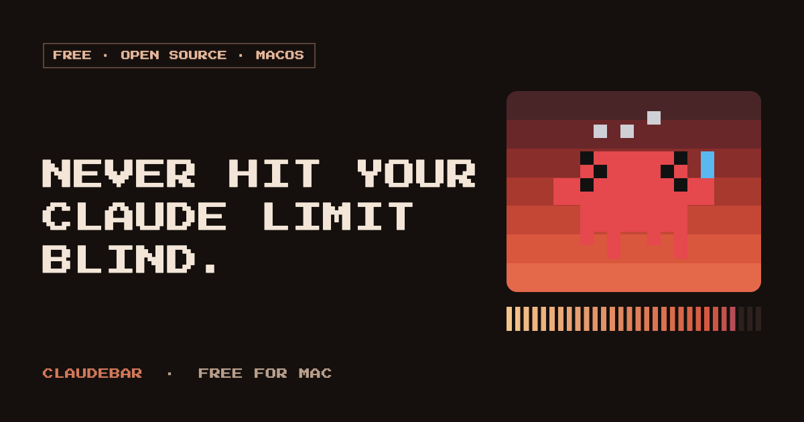

# ClaudeBar



A free, open source macOS menu bar app that shows your Claude **5-hour** and **weekly** usage, next to
**Clawd**, a tiny pixel creature who gets nervous before you do.

**[Landing page](https://ethan20224.github.io/ClaudeBar-app/)** · **[Download](https://github.com/ethan20224/ClaudeBar-app/releases/latest/download/ClaudeBar.dmg)** · [Feedback](https://github.com/ethan20224/ClaudeBar-app/issues/new/choose)

> Unofficial. Not affiliated with or endorsed by Anthropic. Claude is a trademark of Anthropic.

## Install

1. Download `ClaudeBar.dmg` from the [latest release](https://github.com/ethan20224/ClaudeBar-app/releases/latest).
2. Open it and drag ClaudeBar onto Applications.
3. The app is not signed with an Apple developer certificate, so macOS blocks the first launch.
   Open **System Settings, Privacy and Security**, scroll to the message about ClaudeBar and click **Open Anyway**.
   Or run this once in Terminal:

   ```
   xattr -dr com.apple.quarantine /Applications/ClaudeBar.app
   ```

Needs macOS 14 or later. On first launch press **Connect** (see [PRIVACY.md](PRIVACY.md) for exactly what that does),
or choose "Paste key instead".

## What you get

- Your 5-hour window and weekly usage in the menu bar and a popover, with a countdown to the reset.
- A plan badge (Pro or Max) when ClaudeBar can recognize your plan, and light and dark themes.
- Clawd, with seven moods that follow your real usage: idle, working, napping, sweating at 75%, red-hot at 90%,
  a ghost at 100%, and a finish line when your limit resets.
- The Clawdex: 424 costumes across 26 collections, outfits that follow the calendar, and collectible cards in five finishes you can share or save as an image.
- Notifications at 75, 90 and 100 percent, and optional launch at login.

## Build from source

```
git clone https://github.com/ethan20224/ClaudeBar-app.git
cd ClaudeBar
swift build -c release          # just the binary
./scripts/build-app.sh          # dist/ClaudeBar.app (universal if your toolchain can)
./scripts/make-dmg.sh           # dist/ClaudeBar.dmg
./scripts/verify-release.sh     # release gates
swift test
```

## How it works, and its limits

ClaudeBar asks claude.ai for your usage the same way the website does. Those pages are not a public API, so a
change on Claude's side can break the app until it is updated. Details and caveats are in [PRIVACY.md](PRIVACY.md).

## Feedback

Bugs, ideas and costume requests are welcome through [issues](https://github.com/ethan20224/ClaudeBar-app/issues/new/choose)
and [discussions](https://github.com/ethan20224/ClaudeBar-app/discussions). Security problems: see [SECURITY.md](SECURITY.md).

## License

[MIT](LICENSE). Pixel fonts: Silkscreen in the app and Press Start 2P on the website, both under the SIL Open Font License. See [THIRD_PARTY.md](THIRD_PARTY.md).
Some Clawdex costumes are pixel tributes to existing franchises and brands; all trademarks belong to their owners.
